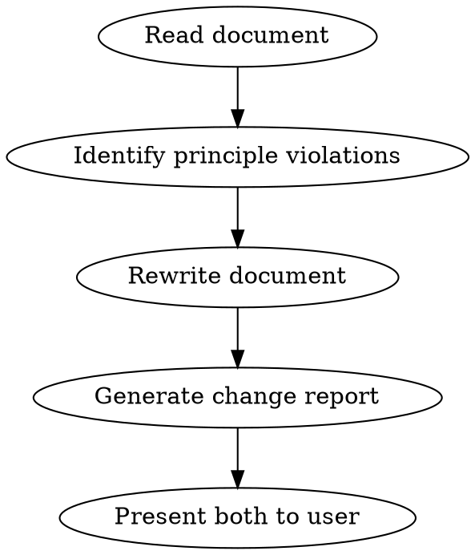

# plsfix

## Overview

Improve spec and instruction documents. Apply the 12 principles that make human and AI communication clear. The skill produces a rewritten document and a change report. The change report maps each change to the principle that required it.

**Core insight:** The same writing principles that help human readers also help AI models, because the models learned from human text. These principles are not prompt tricks. They are the basic rules of clear written communication.

**Sources:** plsfix draws these principles from official prompt-engineering guidance from [Anthropic](https://platform.claude.com/docs/en/build-with-claude/prompt-engineering/overview), [Google](https://ai.google.dev/gemini-api/docs/prompting-strategies), [OpenAI](https://platform.openai.com/docs/guides/prompt-engineering), and [Microsoft](https://learn.microsoft.com/en-us/azure/ai-foundry/openai/concepts/prompt-engineering).

## When to Use

- A spec or requirements document feels vague, or it produces bad results
- Team members or an AI system often misread an instruction document
- A prompt or brief generates generic, off-target output
- The document grew without a plan, and it lost coherence
- The user says "fix this," "improve this," or "make this clearer" about an instruction document

## Flags

### `--help`

When the user runs this skill with the `--help` flag (for example, `/plsfix --help`), skip the workflow below. Read the file `help.md` in this skill's folder. Show its exact contents to the user. Stop after that.

### `--version`

When the user runs this skill with the `--version` flag (for example, `/plsfix --version`), skip the workflow below. Instead, follow these steps:

1. Read the installed version from this skill's manifest: `.claude-plugin/plugin.json` if present, else `.codex-plugin/plugin.json`, else `gemini-extension.json` — whichever file exists for this platform install. If none of these files exist (a bare Claude Code skill has only `SKILL.md`), read the topmost version heading in `CHANGELOG.md` instead.
2. Print: `plsfix v<installed-version>`
3. Find this skill's GitHub source repo (best-effort update check):
   a. If `.git` exists here and `git remote get-url origin` resolves to a `github.com` URL, use that `owner/repo`.
   b. If step a does not find a repo, search this skill's `README.md` for the first `https://github.com/<owner>/<repo>` URL. Use that repo.
   c. If neither step finds a repo, or the `gh` CLI is not installed or authenticated, stop here. Do not print a status line or an error.
4. If step 3 found a repo, run `gh api repos/<owner>/<repo>/releases/latest -q .tag_name` (strip a leading `v`). Compare the result to the installed version:
   - Equal → append: `Status: up to date`
   - Installed is older → append: `Status: newer version available (v<latest>). To update: if you installed this via a Claude Code marketplace, run /plugin marketplace update <marketplace-name> then reinstall; otherwise, git pull in your install directory if it's a git checkout, or re-copy from https://github.com/<owner>/<repo> per this README's Installation section.`
   - Installed is newer → append: `Status: ahead of latest release (development checkout)`
   - If the API call fails for any reason (a network problem, an authentication problem, a rate limit, or a bad tag), do not print a status line or an error.
5. Stop here. Do not run the workflow below.

### `--ste`

When the user runs this skill with the `--ste` flag, do not skip the workflow. `--ste` works differently than `--help` and `--version`. Those two flags stop the workflow before Step 1. `--ste` adds extra checks inside Steps 1 through 3. Step 4 runs the same as always.

The user can give `--ste` before or after the document path. Both forms work:
- `/plsfix --ste <path-to-document>`
- `/plsfix <path-to-document> --ste`

When `--ste` is active, the workflow changes in three places:

1. **Step 1 (Diagnose):** after you check the 12 principles, also check the document against the 16 rules in `references/ste100.md` (in this skill's folder). These are ASD-STE100 (Simplified Technical English) rules. For each STE violation, note its location and which rule (R1-R16) it breaks.
2. **Step 2 (Rewrite):** apply STE fixes along with the principle fixes. Use one word per meaning. Write short, simple sentences. Use active voice. Write procedure steps as direct commands.
3. **Step 3 (Report):** add a new table titled **STE Compliance**. Place it right after the **Principles Not Triggered** line, and after the **Split Candidates** section if one exists. Use this schema:

```
## STE Compliance

| # | Location | STE Rule | Before (summary) | After (summary) | Rationale |
|---|----------|----------|-------------------|------------------|-----------|
| 1 | Section 2, para 3 | R1: One word, one meaning | Document used "commence," "initiate," and "begin" for the same action | Standardized on "start" throughout | Mixed terms for one action force the reader to check they mean the same thing |
```

If the document has no STE violations, leave out the **STE Compliance** section. Do not add an empty one.

If the user does not pass `--ste`, skip everything above. The workflow runs exactly as it does today.

## The 12 Principles

The principles follow a fixed order of use: structure the document first (P1-P4), then sharpen content (P5-P8), then refine delivery (P9-P12). Read `references/principles.md` (in this skill's folder) for the full table of each principle, its one-liner, and the symptom or diagnostic that shows it applies. Consult it during Step 1 below.

## Workflow



### Step 1: Read and Diagnose

Read the full document. Check each section or paragraph against all 12 principles, in order: Structure (P1-P4), then Content (P5-P8), then Delivery (P9-P12). For each violation, note its location and the principle it violates.

**Agent-config and harness files need an extra check.** These files include `CLAUDE.md`, `AGENTS.md`, `GEMINI.md`, `MEMORY.md`, and `SKILL.md`. You can recognize them by their filename, or because they live in a `.claude/`, `.codex/`, or `skills/` folder.

For these files, also check P4 for a split-candidate section. A split-candidate section is long. It is needed only sometimes, not on every load. Examples include troubleshooting runbooks, long tables, old history notes, and long examples.

A split-candidate section is a P4 structural problem, like any other P4 violation. But the fix is not better wording. The fix is moving the section to a separate reference file and leaving a pointer behind.

Do not move the section yourself. Moving a section across multiple files is outside this skill's single-document scope. Instead, flag the split candidate in the change report (see Step 3). Tell the user to run `tokentamer --fix`. That command performs the split.

### Step 2: Rewrite

Apply fixes to produce a clean, improved version of the document. Keep the author's intent, voice, and structure where you can. Make only the changes each principle needs.

**Rewriting rules:**
- Do not add content the author did not intend. Do not add scope the document never had.
- Do not remove content unless it directly breaks a principle. Example: remove a "don't" instruction only to replace it with a positive instruction.
- When you add specific detail for P5, mark each assumed detail with `[CONFIRM: assumed detail]`. This lets the author check it.
- When you add examples for P8, take them from the document's own context. If the document has no relevant context, mark the spot with `[EXAMPLE NEEDED: describe what kind]`.
- When you add structural markup for P4, use the delimiter style the document already uses. If the document uses no delimiter style, use markdown headers for documents written for humans, and XML tags for prompts written for an AI.
- When you add an output contract for P7, base the format and constraints on what the document already implies. Mark each assumption with `[CONFIRM]`.
- Keep the original section headings. Rename a heading only when P2 (one ask per section) requires it.

### Step 3: Generate Change Report

Make a markdown table. List every change in it:

```
## plsfix Change Report

| # | Location | Principle | Before (summary) | After (summary) | Rationale |
|---|----------|-----------|-------------------|-----------------|-----------|
| 1 | Section 2, para 1 | P5: Be specific | "Build a good dashboard" | "Build a Grafana dashboard showing p95 latency, error rate, and throughput for the payments service" | Original lacked target tool, metrics, and scope |
| 2 | Section 3 | P9: Say what to do | "Don't use jargon" | "Use plain language a non-technical stakeholder would understand" | Rewrote the negative instruction as a positive one |
| 3 | Section 1 | P4: Use structural markup | Instructions, context, and examples mixed in a single block | Separated with `### Instructions`, `### Context`, and `### Examples` headers | The reader could not tell instructions apart from reference material |
```

**Report rules:**
- Use one row per change. Group tightly related changes on the same sentence into a single row.
- Always cite the principle by number and name.
- Write "Before" and "After" as short summaries or direct quotes. Do not write full paragraphs.
- In "Rationale," explain in one sentence why the change improves the document.
- If a principle has no violations, do not add a "no changes" row. Leave it out without comment.
- End the report with a **Principles Not Triggered** line. This line lists each of P1-P12 that needed no changes. It confirms that you checked every principle.
- If Step 1 flagged any P4 split candidates (harness and skill files only — see Step 1), add a **Split Candidates** section below the table. For each split candidate, list its section name, its rough size, and why it is only needed sometimes. Do not give it a Before/After row; this skill does not perform the split itself. Instead, tell the user to run `tokentamer --fix`, which performs the split.
- If `--ste` was active (see the `--ste` flag section) and the document had STE violations, add an **STE Compliance** section after **Principles Not Triggered**, and after **Split Candidates** if one is present.

### Step 4: Present

Show the user two things:
1. The change report. This lets them review what changed and why.
2. The rewritten document, in full, ready to use.

Then ask: *"Do you want to adjust any [CONFIRM] items, or revert any changes?"*

## Common Mistakes

- **Over-specifying:** The document gets too much detail. It becomes brittle and cannot adapt to context. Fix: use `[CONFIRM]` tags for each assumption. Do not state details you do not know as fact.
- **Rewriting voice:** The rewrite strips the author's tone. It replaces that tone with generic "spec language." Fix: match the document's original register. If the original was casual, keep it casual, but make it clearer.
- **Inventing scope:** The rewrite adds requirements the author never mentioned, because "the document should have had them." Fix: add only the specific detail that makes the author's existing intent clear. Never add new intent.
- **Principle-stuffing:** The rewrite forces every principle into every section, even where the original was already fine. Fix: do not change a section that already works well. Report only real violations.
- **Over-structuring:** The rewrite adds XML tags and delimiters to a simple, short document that was already clear. Fix: structural markup (P4) helps most on a long document, or one that mixes several kinds of content. A three-sentence instruction does not need headers.
