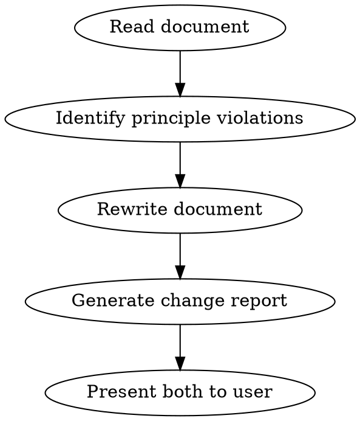

# ASD-STE100 Support Implementation Plan

> **For agentic workers:** REQUIRED SUB-SKILL: Use superpowers:subagent-driven-development (recommended) or superpowers:executing-plans to implement this plan task-by-task. Steps use checkbox (`- [ ]`) syntax for tracking.

**Goal:** Add an opt-in `--ste` flag that layers ASD-STE100 (Simplified Technical English) rules on top of plsfix's 12-principle rewrite, and rewrite plsfix's own instructional files into STE style.

**Architecture:** This is a documentation-only change — no application code. Four markdown files change (one new, three rewritten) at the repo root, with byte-identical mirror copies kept under `skills/plsfix/` for Codex/Gemini/Antigravity parity. There is no automated test suite; verification is a `diff`-based mirror-parity check plus a manual behavioral invocation of the skill.

**Tech Stack:** Markdown. `bash` (`git`, `diff`, `cp`) for file sync and verification. No application code, no test framework.

**Spec:** `docs/superpowers/specs/2026-11-14-ste100-support-design.md`

---

## Task 1: New reference file `references/ste100.md`

**Files:**
- Create: `references/ste100.md`
- Create: `skills/plsfix/references/ste100.md` (byte-identical mirror)

- [ ] **Step 1: Write `references/ste100.md`**

Create the file with this exact content:

```markdown
# ASD-STE100 Rules — Condensed Reference

Read this file only when the `--ste` flag is active. See `SKILL.md`'s `--ste` flag section.

This file gives a short, practical list of ASD-STE100 (Simplified Technical English) writing rules. The real ASD-STE100 specification has about 900 approved and not-approved words, plus many grammar rules. This file does not repeat the full specification. It gives you 16 core rules you can check and apply by hand. Treat `--ste` as a practical aid, not full ASD-STE100 certification.

## The 16 Rules

| # | Rule | What to check | Example fix |
|---|------|----------------|--------------|
| R1 | One word, one meaning | Does the document use different words for the same idea? | "Commence," "initiate," and "begin" all become "start." |
| R2 | Simple sentences | Does a sentence have more than one main clause, or more than about 20 words? | Split the sentence into two short sentences. |
| R3 | Active voice | Is the sentence passive, like "the file is opened by the user"? | Rewrite it as active: "The user opens the file." |
| R4 | Simple verb tenses | Does the sentence use a complex tense, such as future perfect or a conditional chain? | Rewrite it in the present tense or the imperative. |
| R5 | Procedure steps as direct commands | Is a step written as a description instead of a command? | "The panel should be opened" becomes "Open the panel." |
| R6 | No noun strings | Are three or more nouns stacked as modifiers? | "Data validation error report" becomes "report of data validation errors." |
| R7 | No gerunds as adjectives | Does an "-ing" word modify a noun? | "The operating procedure" becomes "the procedure for operation." |
| R8 | No gerunds as nouns, where a simpler noun exists | Does an "-ing" word stand in for a plainer noun? | "The opening of the file" becomes "opening the file," or a plain noun. |
| R9 | One instruction per sentence | Does a sentence chain two or more commands with "and"? | Split the sentence into separate steps. |
| R10 | No ambiguous pronouns | Does "it," "this," or "that" point to something other than the nearest noun? | Repeat the noun instead of using the pronoun. |
| R11 | No stacked past-participle modifiers | Are two or more "-ed" words stacked before a noun? | Reword the sentence to separate the modifiers. |
| R12 | No vague quantifiers | Does the sentence say "some," "several," or "a few" when an exact number is known? | State the exact count or range. |
| R13 | Keep articles | Does the sentence drop "a" or "the" in a terse, telegraphic style? | Add the article back. |
| R14 | Plain connector words | Does the sentence use a formal word when a plain word means the same thing? | "Utilize" becomes "use." "Prior to" becomes "before." |
| R15 | One topic per paragraph | Does a paragraph cover more than one idea? | Split the paragraph by topic. |
| R16 | Spell out ambiguous abbreviations | Is an abbreviation unclear in context on first use? | Write the full term first, then the short form. |

## Sources

This list is a short summary. It draws from the ASD-STE100 specification's "Writing Rules" chapter, and from public summaries by the Simplified Technical English Maintenance Group (ste100.org) and by the Wikipedia article "Simplified Technical English."
```

- [ ] **Step 2: Spot-check the 16 rules for accuracy**

Check each of R1-R16 against the sources named in the file's own "Sources" section — the ASD-STE100 specification's "Writing Rules" chapter, and public summaries from the Simplified Technical English Maintenance Group (ste100.org) and the Wikipedia article "Simplified Technical English." Confirm each rule's name and description accurately reflects a real ASD-STE100 writing rule, and that no rule is invented or misattributed.

- [ ] **Step 3: Create the mirror copy**

Run:
```bash
mkdir -p skills/plsfix/references
cp references/ste100.md skills/plsfix/references/ste100.md
```

- [ ] **Step 4: Verify the mirror matches**

Run: `diff references/ste100.md skills/plsfix/references/ste100.md`
Expected: no output (files identical).

- [ ] **Step 5: Confirm `GEMINI.md` is NOT touched**

`references/ste100.md` is read on demand, only when `--ste` is active — the same loading pattern as `help.md` (read on demand via `--help`), not the always-loaded pattern of `SKILL.md` and `references/principles.md` (which `GEMINI.md` `@`-includes directly). Run `cat GEMINI.md` and confirm it still contains only its original two `@`-include lines (for `skills/plsfix/SKILL.md` and `skills/plsfix/references/principles.md`) with no new line added for `ste100.md`. Do not edit `GEMINI.md` in this task or any other task in this plan.

- [ ] **Step 6: Commit**

```bash
git add references/ste100.md skills/plsfix/references/ste100.md
git commit -m "$(cat <<'EOF'
Add ASD-STE100 condensed rule reference

Co-Authored-By: Claude Sonnet 5 <noreply@anthropic.com>
EOF
)"
```

---

## Task 2: Rewrite `references/principles.md` into STE

**Files:**
- Modify: `references/principles.md` (full rewrite)
- Modify: `skills/plsfix/references/principles.md` (mirror)

- [ ] **Step 1: Replace the contents of `references/principles.md`**

Replace the entire file with this exact content (principle names, numbering, and table structure are unchanged from the current version — only grammar and vocabulary are tightened to ASD-STE100 style):

```markdown
# The 12 Principles — Full Reference

Consult this file during Step 1 (Read and Diagnose). Check the document against each principle, or look up which principle matches a symptom you have found.

These principles follow a fixed order: structure the document first, then sharpen its content, then refine its delivery.

### Phase 1: Structure (fix the document's organization)

| # | Principle | One-liner | Symptom it fixes |
|---|-----------|-----------|------------------|
| P1 | **Context first, ask last** | Lead with background and constraints. Close with the actual request. Never bury the ask in the middle. | Readers miss key requirements, and the output addresses secondary concerns instead. *Diagnostic: core requirement buried in paragraph 4 of 6.* |
| P2 | **One ask per section** | Split a multi-goal paragraph so each section has exactly one objective. | The output swings between competing goals, or it drops some of them. *Diagnostic: section tries to accomplish multiple goals.* |
| P3 | **Break it into steps** | Break a compound instruction into sequential, numbered steps. | The output jumbles steps, or it skips parts of the task. *Diagnostic: run-on paragraph with 3+ distinct instructions.* |
| P4 | **Use structural markup** | Separate instructions, context, examples, and inputs with consistent delimiters (XML tags, markdown headers, or `---` separators). | A reader or an AI confuses the instructions with the examples, or confuses the context with the actual request. *Diagnostic: instructions, examples, and context mixed together with no separators.* |

### Phase 2: Content (make the message clear)

| # | Principle | One-liner | Symptom it fixes |
|---|-----------|-----------|------------------|
| P5 | **Be specific, not abstract** | Replace vague nouns with concrete details: audience, format, scope, quantities. | The output is generic or shallow. *Diagnostic: "Build a good X", "make it effective", "ensure quality".* |
| P6 | **Name your audience** | State who will read or act on the output, and what they already know. | Tone, depth, or vocabulary is wrong for the reader. *Diagnostic: no mention of who the output is for.* |
| P7 | **Define the output contract** | Specify what "done" looks like: format, length, structure, required fields. | The output is correct in substance but wrong in shape, length, or structure. *Diagnostic: the document never states the output's format, length, or structure.* |
| P8 | **Show, don't tell** | Add 1-3 examples of the output you want. | A reader or an AI guesses wrong about what "good" looks like. *Diagnostic: the document has no examples of the output you want, anywhere.* |

### Phase 3: Delivery (improve the tone and wording)

| # | Principle | One-liner | Symptom it fixes |
|---|-----------|-----------|------------------|
| P9 | **Say what to do, not what to avoid** | Turn "don't" and "avoid" instructions into positive ones. | The forbidden behavior still appears. The instructions feel restrictive, not helpful. *Diagnostic: multiple "don't", "avoid", "never" instructions.* |
| P10 | **Make the stakes real** | State why this matters: who benefits, what breaks if done wrong, what success enables. | Readers follow the instructions automatically, without judgment or care. *Diagnostic: the document never explains why the task matters.* |
| P11 | **Give an out for uncertainty** | Clearly state what to do when information is missing, the request is ambiguous, or the task is out of scope. | The AI fabricates answers, guesses with false confidence, or fails silently when it cannot finish the task as written. *Diagnostic: the document gives no guidance for when the task is uncertain or out of scope.* |
| P12 | **Resolve contradictions** | Make sure no two instructions conflict. When a conflict exists, state which instruction takes priority. | A reader or an AI wastes effort trying to resolve the ambiguity, or silently picks the wrong side of a conflict. *Diagnostic: two instructions that contradict each other (for example, "be brief" and "be comprehensive").* |
```

- [ ] **Step 2: Read it back and compare against the old version**

Run: `git diff references/principles.md`
Confirm: all 12 principle names (bold terms, e.g. **Context first, ask last**) are unchanged, all P-numbers P1-P12 are unchanged, no principle was added, removed, or reordered, and every quoted diagnostic example (e.g. `"Build a good X"`, `"be brief" and "be comprehensive"`) is byte-identical to the original.

- [ ] **Step 3: Sync the mirror**

```bash
cp references/principles.md skills/plsfix/references/principles.md
diff references/principles.md skills/plsfix/references/principles.md
```
Expected: no output from `diff`.

- [ ] **Step 4: Commit**

```bash
git add references/principles.md skills/plsfix/references/principles.md
git commit -m "$(cat <<'EOF'
Rewrite references/principles.md into ASD-STE100 style

Co-Authored-By: Claude Sonnet 5 <noreply@anthropic.com>
EOF
)"
```

---

## Task 3: Rewrite `help.md` into STE, add `--ste` to USAGE/FLAGS

**Files:**
- Modify: `help.md` (full rewrite)
- Modify: `skills/plsfix/help.md` (mirror)

- [ ] **Step 1: Replace the contents of `help.md`**

Replace the entire file with this exact content:

```
plsfix — rewrite vague specs, prompts, and instructions into clear, actionable ones

WHAT IT DOES
  Improves spec documents, prompts, requirements docs, briefs, and other
  written instructions. These are instructions meant to drive action by
  humans or AI.

  plsfix applies 12 writing principles in three phases: Structure,
  Content, and Delivery. It draws these principles from Anthropic,
  Google, OpenAI, and Microsoft prompt-engineering guidance.

  plsfix flags each principle violation. It rewrites the document with
  minimal changes, and marks each assumed detail with a [CONFIRM] tag.
  It then produces a change report. Each report row names the
  principle and gives a Rationale for the edit.

WHAT IT NEEDS
  - A target document to read and improve: a spec, a prompt, a
    requirements doc, a brief, or any other instruction set

USAGE
  /plsfix <path-to-document>   Improve the given document
  /plsfix <path-to-document> --ste   Improve the document, enforcing ASD-STE100 language rules
  /plsfix --help                Show this message and exit

FLAGS
  --help    Show this help message without making any changes
  --ste     Also enforce ASD-STE100 (Simplified Technical English) language rules
```

Note: the `--version` flag is intentionally left undocumented here — it is a pre-existing gap in this file (confirmed against `SKILL.md`, which does document it) and is explicitly out of scope for this change (see the design spec's Non-Goals).

Note on alignment: the original `USAGE` block aligned its description column across lines. The new `<path-to-document> --ste` line is longer than the other two, so it cannot share that same column position without pushing the whole block to an impractical width. This is the exact literal line text approved in the design spec (Design §1) — do not re-align the other two lines to compensate; leave the block exactly as shown above, with the new line's description starting 3 spaces after `--ste` rather than at the older shared column.

- [ ] **Step 2: Read it back**

Run: `cat help.md`
Confirm: the `USAGE` block has three lines (`<path-to-document>`, `<path-to-document> --ste`, `--help`) and the `FLAGS` block has two lines (`--help`, `--ste`), matching the content above exactly.

- [ ] **Step 3: Sync the mirror**

```bash
cp help.md skills/plsfix/help.md
diff help.md skills/plsfix/help.md
```
Expected: no output from `diff`.

- [ ] **Step 4: Commit**

```bash
git add help.md skills/plsfix/help.md
git commit -m "$(cat <<'EOF'
Rewrite help.md into ASD-STE100 style, document --ste flag

Co-Authored-By: Claude Sonnet 5 <noreply@anthropic.com>
EOF
)"
```

---

## Task 4: Rewrite `SKILL.md` into STE, add the `--ste` flag

**Files:**
- Modify: `SKILL.md` (full rewrite)
- Modify: `skills/plsfix/SKILL.md` (mirror)

- [ ] **Step 1: Replace the contents of `SKILL.md`**

Replace the entire file with this exact content. The YAML frontmatter (`name:`, `description:`) is unchanged — it is shared, byte-identical metadata with `.codex-plugin/plugin.json` and `gemini-extension.json`, and is out of scope for this rewrite (see the design spec, Design §3):

```markdown
---
name: plsfix
description: Use when improving spec documents, instruction sets, prompts, requirements docs, briefs, or any written instructions meant to drive action from humans or AI - rewrites vague, disorganized, or ineffective instructions into clear, actionable ones
---

# plsfix

## Overview

Improve spec and instruction documents. Apply the 12 principles that make human and AI communication clear. The skill produces a rewritten document and a change report. The change report maps each change to the principle that required it.

**Core insight:** The same writing principles that help human readers also help AI models, because the models learned from human text. These principles are not prompt tricks. They are the basic rules of clear written communication.

**Sources:** plsfix draws these principles from official prompt-engineering guidance from [Anthropic](https://platform.claude.com/docs/en/build-with-claude/prompt-engineering/overview), [Google](https://ai.google.dev/gemini-api/docs/prompting-strategies), [OpenAI](https://platform.openai.com/docs/guides/prompt-engineering), and [Microsoft](https://learn.microsoft.com/en-us/azure/ai-foundry/openai/concepts/prompt-engineering).

## When to Use

- A spec or requirements document feels vague, or it produces bad results
- Team members or an AI system often misread an instruction document
- A prompt or brief generates generic, off-target output
- The document grew without a plan, and it lost coherence
- The user says "fix this," "improve this," or "make this clearer" about an instruction document

## Flags

### `--help`

When the user runs this skill with the `--help` flag (for example, `/plsfix --help`), skip the workflow below. Read the file `help.md` in this skill's folder. Show its exact contents to the user. Stop after that.

### `--version`

When the user runs this skill with the `--version` flag (for example, `/plsfix --version`), skip the workflow below. Instead, follow these steps:

1. Read the installed version from this skill's manifest: `.claude-plugin/plugin.json` if present, else `.codex-plugin/plugin.json`, else `gemini-extension.json` — whichever file exists for this platform install. If none of these files exist (a bare Claude Code skill has only `SKILL.md`), read the topmost version heading in `CHANGELOG.md` instead.
2. Print: `plsfix v<installed-version>`
3. Find this skill's GitHub source repo (best-effort update check):
   a. If `.git` exists here and `git remote get-url origin` resolves to a `github.com` URL, use that `owner/repo`.
   b. If step a does not find a repo, search this skill's `README.md` for the first `https://github.com/<owner>/<repo>` URL. Use that repo.
   c. If neither step finds a repo, or the `gh` CLI is not installed or authenticated, stop here. Do not print a status line or an error.
4. If step 3 found a repo, run `gh api repos/<owner>/<repo>/releases/latest -q .tag_name` (strip a leading `v`). Compare the result to the installed version:
   - Equal → append: `Status: up to date`
   - Installed is older → append: `Status: newer version available (v<latest>). To update: if you installed this via a Claude Code marketplace, run /plugin marketplace update <marketplace-name> then reinstall; otherwise, git pull in your install directory if it's a git checkout, or re-copy from https://github.com/<owner>/<repo> per this README's Installation section.`
   - Installed is newer → append: `Status: ahead of latest release (development checkout)`
   - If the API call fails for any reason (a network problem, an authentication problem, a rate limit, or a bad tag), do not print a status line or an error.
5. Stop here. Do not run the workflow below.

### `--ste`

When the user runs this skill with the `--ste` flag, do not skip the workflow. `--ste` works differently than `--help` and `--version`. Those two flags stop the workflow before Step 1. `--ste` adds extra checks inside Steps 1 through 3. Step 4 runs the same as always.

The user can give `--ste` before or after the document path. Both forms work:
- `/plsfix --ste <path-to-document>`
- `/plsfix <path-to-document> --ste`

When `--ste` is active, the workflow changes in three places:

1. **Step 1 (Diagnose):** after you check the 12 principles, also check the document against the 16 rules in `references/ste100.md` (in this skill's folder). These are ASD-STE100 (Simplified Technical English) rules. For each STE violation, note its location and which rule (R1-R16) it breaks.
2. **Step 2 (Rewrite):** apply STE fixes along with the principle fixes. Use one word per meaning. Write short, simple sentences. Use active voice. Write procedure steps as direct commands.
3. **Step 3 (Report):** add a new table titled **STE Compliance**. Place it right after the **Principles Not Triggered** line, and after the **Split Candidates** section if one exists. Use this schema:

```
## STE Compliance

| # | Location | STE Rule | Before (summary) | After (summary) | Rationale |
|---|----------|----------|-------------------|------------------|-----------|
| 1 | Section 2, para 3 | R1: One word, one meaning | Document used "commence," "initiate," and "begin" for the same action | Standardized on "start" throughout | Mixed terms for one action force the reader to check they mean the same thing |
```

If the document has no STE violations, leave out the **STE Compliance** section. Do not add an empty one.

If the user does not pass `--ste`, skip everything above. The workflow runs exactly as it does today.

## The 12 Principles

The principles follow a fixed order of use: structure the document first (P1-P4), then sharpen content (P5-P8), then refine delivery (P9-P12). Read `references/principles.md` (in this skill's folder) for the full table of each principle, its one-liner, and the symptom or diagnostic that shows it applies. Consult it during Step 1 below.

## Workflow



### Step 1: Read and Diagnose

Read the full document. Check each section or paragraph against all 12 principles, in order: Structure (P1-P4), then Content (P5-P8), then Delivery (P9-P12). For each violation, note its location and the principle it violates.

**Agent-config and harness files need an extra check.** These files include `CLAUDE.md`, `AGENTS.md`, `GEMINI.md`, `MEMORY.md`, and `SKILL.md`. You can recognize them by their filename, or because they live in a `.claude/`, `.codex/`, or `skills/` folder.

For these files, also check P4 for a split-candidate section. A split-candidate section is long. It is needed only sometimes, not on every load. Examples include troubleshooting runbooks, long tables, old history notes, and long examples.

A split-candidate section is a P4 structural problem, like any other P4 violation. But the fix is not better wording. The fix is moving the section to a separate reference file and leaving a pointer behind.

Do not move the section yourself. Moving a section across multiple files is outside this skill's single-document scope. Instead, flag the split candidate in the change report (see Step 3). Tell the user to run `tokentamer --fix`. That command performs the split.

### Step 2: Rewrite

Apply fixes to produce a clean, improved version of the document. Keep the author's intent, voice, and structure where you can. Make only the changes each principle needs.

**Rewriting rules:**
- Do not add content the author did not intend. Do not add scope the document never had.
- Do not remove content unless it directly breaks a principle. Example: remove a "don't" instruction only to replace it with a positive instruction.
- When you add specific detail for P5, mark each assumed detail with `[CONFIRM: assumed detail]`. This lets the author check it.
- When you add examples for P8, take them from the document's own context. If the document has no relevant context, mark the spot with `[EXAMPLE NEEDED: describe what kind]`.
- When you add structural markup for P4, use the delimiter style the document already uses. If the document uses no delimiter style, use markdown headers for documents written for humans, and XML tags for prompts written for an AI.
- When you add an output contract for P7, base the format and constraints on what the document already implies. Mark each assumption with `[CONFIRM]`.
- Keep the original section headings. Rename a heading only when P2 (one ask per section) requires it.

### Step 3: Generate Change Report

Make a markdown table. List every change in it:

```
## plsfix Change Report

| # | Location | Principle | Before (summary) | After (summary) | Rationale |
|---|----------|-----------|-------------------|-----------------|-----------|
| 1 | Section 2, para 1 | P5: Be specific | "Build a good dashboard" | "Build a Grafana dashboard showing p95 latency, error rate, and throughput for the payments service" | Original lacked target tool, metrics, and scope |
| 2 | Section 3 | P9: Say what to do | "Don't use jargon" | "Use plain language a non-technical stakeholder would understand" | Rewrote the negative instruction as a positive one |
| 3 | Section 1 | P4: Use structural markup | Instructions, context, and examples mixed in a single block | Separated with `### Instructions`, `### Context`, and `### Examples` headers | The reader could not tell instructions apart from reference material |
```

**Report rules:**
- Use one row per change. Group tightly related changes on the same sentence into a single row.
- Always cite the principle by number and name.
- Write "Before" and "After" as short summaries or direct quotes. Do not write full paragraphs.
- In "Rationale," explain in one sentence why the change improves the document.
- If a principle has no violations, do not add a "no changes" row for it. Leave it out without comment.
- End the report with a **Principles Not Triggered** line. This line lists each of P1-P12 that needed no changes. It confirms that you checked every principle.
- If Step 1 flagged any P4 split candidates (harness and skill files only — see Step 1), add a **Split Candidates** section below the table. For each split candidate, list its section name, its rough size, and why it is only needed sometimes. Do not give it a Before/After row; this skill does not perform the split itself. Instead, tell the user to run `tokentamer --fix`, which performs the split.
- If `--ste` was active (see the `--ste` flag section) and the document had STE violations, add an **STE Compliance** section after **Principles Not Triggered**, and after **Split Candidates** if one is present.

### Step 4: Present

Show the user two things:
1. The change report. This lets them review what changed and why.
2. The rewritten document, in full, ready to use.

Then ask: *"Do you want to adjust any [CONFIRM] items, or revert any changes?"*

## Common Mistakes

- **Over-specifying:** The document gets too much detail. It becomes brittle and cannot adapt to context. Fix: use `[CONFIRM]` tags for each assumption. Do not state details you do not know as fact.
- **Rewriting voice:** The rewrite strips the author's tone. It replaces that tone with generic "spec language." Fix: match the document's original register. If the original was casual, keep it casual, but make it clearer.
- **Inventing scope:** The rewrite adds requirements the author never mentioned, because "the document should have had them." Fix: add only the specific detail that makes the author's existing intent clear. Never add new intent.
- **Principle-stuffing:** The rewrite forces every principle into every section, even where the original was already fine. Fix: do not change a section that already works well. Report only real violations.
- **Over-structuring:** The rewrite adds XML tags and delimiters to a simple, short document that was already clear. Fix: structural markup (P4) helps most on a long document, or one that mixes several kinds of content. A three-sentence instruction does not need headers.
```

- [ ] **Step 2: Read it back and compare against the old version**

Run: `git diff SKILL.md`
Confirm:
- The frontmatter (`name:`, `description:`) is byte-identical to before.
- All 4 workflow steps (Read and Diagnose, Rewrite, Generate Change Report, Present) are still present, in the same order, with the same headings.
- The `digraph plsfix { ... }` code block is byte-identical to before.
- `--help` and `--version` still behave as terminal/short-circuit flags (Steps say "skip the workflow below").
- The new `--ste` subsection appears after `--version` and before `## The 12 Principles`.
- All 5 Common Mistakes bullets are still present, with the same bold labels (Over-specifying, Rewriting voice, Inventing scope, Principle-stuffing, Over-structuring).
- The harness-file split-candidate paragraph (from a prior change) is still present under Step 1, mentioning `tokentamer --fix`.

- [ ] **Step 3: Sync the mirror**

```bash
cp SKILL.md skills/plsfix/SKILL.md
diff SKILL.md skills/plsfix/SKILL.md
```
Expected: no output from `diff`.

- [ ] **Step 4: Commit**

```bash
git add SKILL.md skills/plsfix/SKILL.md
git commit -m "$(cat <<'EOF'
Add --ste flag, rewrite SKILL.md into ASD-STE100 style

Co-Authored-By: Claude Sonnet 5 <noreply@anthropic.com>
EOF
)"
```

---

## Task 5: Behavioral verification

This task has no file changes — it confirms the rewritten `SKILL.md` actually produces the behavior it describes, by running the skill. This is the project's only available form of "test," since there is no automated test suite for a documentation-only skill.

**Files:** none (verification only)

- [ ] **Step 1: Create a sample document with clear STE violations**

Write a short scratch file (for example, in your scratchpad directory, not in this repo) with:
- A passive-voice sentence (e.g., "The configuration file should be edited by the user.")
- A 3+ noun string (e.g., "the data validation error report process")
- A non-imperative procedure step (e.g., "Step 2: The button should then be clicked.")
- Two different words for the same action (e.g., use both "commence" and "start" for the same step)

- [ ] **Step 2: Invoke `/plsfix <path-to-sample> --ste`**

Confirm:
- Step 1's diagnosis flags each planted STE issue, tagged with its correct rule number (R3 for the passive sentence, R6 for the noun string, R5 for the non-imperative step, R1 for the inconsistent terms).
- Step 2's rewrite fixes each one.
- Step 3's report includes an **STE Compliance** table, positioned after **Principles Not Triggered** (and after **Split Candidates**, if the sample also triggered that), using the `# | Location | STE Rule | Before (summary) | After (summary) | Rationale` schema.

- [ ] **Step 3: Invoke `/plsfix <path-to-sample>` (no `--ste`)**

Confirm: no STE-related content appears anywhere in the diagnosis, rewrite, or report — behavior matches how plsfix worked before this change.

- [ ] **Step 4: Note the result**

No commit for this task. If either check fails, fix the relevant file from Task 2, 3, or 4, re-sync its mirror, and re-run this task before continuing.

---

## Task 6: Changelog entry

Note on scope: the design spec's Goals and Design §3-4 list `CHANGELOG.md` among the files "left as-is," alongside README.md and the community files — that means its *voice* (marketing/community tone) is not rewritten into STE, not that it never gets a new entry. Design §5 separately and explicitly requires adding a changelog entry for this change. This task does that — it is not a contradiction of the "left as-is" scope rule.

**Files:**
- Modify: `CHANGELOG.md`

- [ ] **Step 1: Add an entry under `[Unreleased]`**

Read the current top of `CHANGELOG.md` first (`git diff` or `Read` the file) to confirm the `## [Unreleased]` heading is still empty since the last release, then add these two bullets directly under it:

```markdown
## [Unreleased]

- Add `--ste` flag: layers ASD-STE100 (Simplified Technical English) language rules on top of the 12-principle rewrite for target documents, with a new `references/ste100.md` rule reference
- Rewrite `SKILL.md`, `references/principles.md`, and `help.md` into ASD-STE100 style, so plsfix's own instructions model the standard it can now apply
```

- [ ] **Step 2: Commit**

```bash
git add CHANGELOG.md
git commit -m "$(cat <<'EOF'
Add changelog entry for ASD-STE100 support

Co-Authored-By: Claude Sonnet 5 <noreply@anthropic.com>
EOF
)"
```

---

## Not part of this plan

- **Version bump and release.** Per the design spec (Design §5), bumping `.codex-plugin/plugin.json` and `gemini-extension.json` and tagging a release happens later, via the existing `/git-release` flow — not as part of this implementation plan.
- **README.md and community files.** Per the design spec's scope, `README.md`, `CONTRIBUTING.md`, `CODE_OF_CONDUCT.md`, and `SECURITY.md` are not touched by this change.
